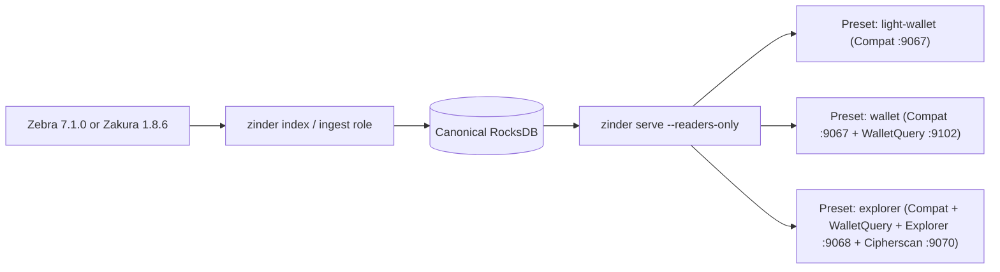

# Zinder

> [!WARNING]
> **Zinder is alpha.** APIs, storage layouts, and deployment topology will change, and a tagged release is not a stability promise. Pin exact versions and expect breaking upgrades.

Zinder is a self-hosted Zcash indexer. It reads an archive [Zebra](https://github.com/ZcashFoundation/zebra) or [Zakura](https://github.com/zakura-core/zakura) node, stores one canonical index, and serves wallets, backends, and optional explorers from that consistent view. Keys, note scanning, and shielded balances stay in the wallet.

## Why choose Zinder

- **One index, multiple protocols.** Serve [lightwalletd](https://github.com/zcash/lightwalletd) `CompactTxStreamer` (with native gRPC-Web for browsers), native `WalletQuery` / `zinder-client`, and optional `ExplorerQuery` + Cipherscan REST compatibility from one store.
- **One binary, zero required config files.** Run `zinder serve --preset <light-wallet|wallet|explorer>` (or Compose `zinder-index` + `zinder-serve`) configured strictly via `ZINDER_*` environment variables, with optional TOML when needed.
- **Reorg-safe snapshots and resumable events.** Pin multiple native calls to one chain epoch so syncs never mix competing tips, and follow blocks and reorgs through durable `ChainEvents` cursors.
- **Serving through node outages.** Keep answering stored block, tree-state, and transparent queries while the node is down, with ingest and broadcast failover across certified Zebra 7.1.0 and Zakura 1.8.6 nodes.
- **Verified data path.** Serve SHA-256 and optional `fs-verity`-verified canonical `ZSHRNG02` settled segments, SHA-256 verified transaction bodies, and verified edge-snapshot bootstraps.

See [Features and roadmap](docs/features.md) for the full breakdown and [Indexer comparison](docs/reference/indexer-comparison.md) for a side-by-side matrix against Zebra, Zakura, ztreamer, Zingod, and Go lightwalletd.

## How a Zinder node fits together



## Quickstart

Start Zinder on Testnet with Docker Compose (requires an archive node URL in `deploy/profiles/testnet/zinder.env` and control token files in `${DEPLOY_CONTROL_SECRETS_DIR}`; zero TOML config files needed):

```bash
export DEPLOY_CONTROL_SECRETS_DIR=/etc/zinder/control-secrets
sudo install -d -o root -g 10001 -m 0750 "$DEPLOY_CONTROL_SECRETS_DIR"
head -c 32 /dev/urandom | od -An -tx1 | tr -d ' \n' | sudo install -o root -g 10001 -m 0440 /dev/stdin "$DEPLOY_CONTROL_SECRETS_DIR/ingest.token"
head -c 32 /dev/urandom | od -An -tx1 | tr -d ' \n' | sudo install -o root -g 10001 -m 0440 /dev/stdin "$DEPLOY_CONTROL_SECRETS_DIR/checkpoint.token"
docker compose --env-file deploy/profiles/testnet/deploy.env -f deploy/docker-compose.yml up -d
```

Or run the unified `zinder` CLI directly against an existing store or node:

```bash
zinder serve --preset wallet --data-dir /var/lib/zinder
```

Select `--preset light-wallet`, `--preset wallet` (default), or `--preset explorer`, and add `--full-blocks` on any preset to retain full raw block bytes.

## Try it without deploying

Connect a wallet, `grpcurl`, or `zinder-client` to the Zcash Foundation's public gRPC-over-TLS endpoints (not websites; see [Endpoints](docs/reference/integration-surfaces.md#endpoints) for limits and retries):

| Protocol | Mainnet | Testnet |
| --- | --- | --- |
| lightwalletd `CompactTxStreamer` | `https://lwd.zfnd.org:443` | `https://testnet.lwd.zfnd.org:443` |
| Native `WalletQuery` (`zinder-client`) | `https://zinder.zfnd.org:443` | `https://testnet.zinder.zfnd.org:443` |

## Mainnet footprint (`v0.26.0`)

Measured on Mainnet against Zebra 7.1.0 on 8 writer cores:

- **`light-wallet`:** ~72 GB disk, ~49–60 min first sync (`CompactTxStreamer`, node-forwarded transparent reads).
- **`wallet` (recommended default):** ~123 GB disk, ~76 min first sync (local transparent indexes, verified node-forwarded transaction bodies).
- **`explorer`:** adds canonical explorer indexes, optional aggregate views, `ExplorerQuery` gRPC, and Cipherscan REST compatibility.

Add `--full-blocks` (`storage.full_blocks = true`) on any preset to retain full raw blocks and transactions locally.

## Cloud & host deployment options

| Target | Supported | Packaging | Notes |
| --- | --- | --- | --- |
| **Linux VM (Docker Compose / systemd)** | Yes *(Recommended)* | [deploy/docker-compose.yml](deploy/docker-compose.yml), [deploy/systemd/zinder.service](deploy/systemd/zinder.service) | `zinder-index` writer + `zinder-serve --readers-only`, cgroup isolation, Prometheus/Grafana profile |
| **Single-volume PaaS (e.g., Railway)** | Yes | `ghcr.io/zcashfoundation/zinder` (`zinder serve`) | Supervised all-in-one container with `:9108` `/healthz` + `/readyz` on one persistent volume |
| **Kubernetes** | Yes *(Single-host RWO)* | [deploy/kubernetes/statefulset.yaml](deploy/kubernetes/statefulset.yaml) | Single-replica `StatefulSet` (`replicas: 1`, `ReadWriteOnce` PVC, `fsGroup: 10001`) |
| **Stateless serverless (Cloud Run, AWS Lambda)** | No *(Planned M3)* | Requires PostgreSQL backend ([ADR-0004](docs/adrs/0004-storage-and-deployment-topologies.md)) | Shared RocksDB secondaries and long-lived sync streams require persistent stateful hosts |

See [Deploying Zinder](docs/runbooks/deploying.md) and [deploy/README.md](deploy/README.md) for host sizing, presets, and deployment details.

## Start here

| You want to | Read |
| --- | --- |
| Explore features, presets, and roadmap | [Features and roadmap](docs/features.md) |
| Match Zinder to your product | [Use cases](docs/use-cases.md) |
| Compare Zcash indexers | [Indexer comparison](docs/reference/indexer-comparison.md) |
| Deploy Zinder (Compose, VM, PaaS, Kubernetes) | [Deploying Zinder](docs/runbooks/deploying.md) and [deploy/README.md](deploy/README.md) |
| Connect a wallet or backend | [Integration surfaces](docs/reference/integration-surfaces.md) |
| Understand the architecture | [How Zinder works](docs/architecture/overview.md) |
| Explore automation, CI, and benchmark scripts | [scripts/README.md](scripts/README.md) |
| Contribute | [Testing](docs/runbooks/testing.md) and [CLAUDE.md](CLAUDE.md) |

Browse the [documentation index](docs/README.md) or the [navigation tree](docs/SUMMARY.md).

## Contributing

Zinder is a Rust workspace with domain crates under `crates/`, unified binary and services under `services/`, deployment manifests in [deploy/README.md](deploy/README.md), and CI/benchmark tooling in [scripts/README.md](scripts/README.md). Run the [default validation gate](docs/runbooks/testing.md#default-validation-gate) before opening a pull request, and include a release-note fragment or waiver per [.changes/README.md](.changes/README.md).
