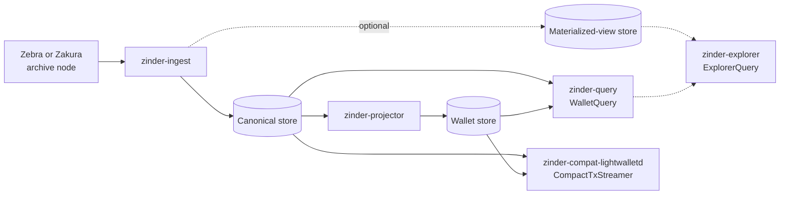

# How Zinder works

This page explains how Zinder is put together: its processes, its stores, and
how a block becomes a wallet response. Read it after the
[README](../../README.md) if you know Zcash but are new to Zinder.

## What Zinder does

Zinder reads blocks from a Zebra or Zakura archive node, indexes them once, and
stores the result on disk. It then serves that one stored view to many
consumers at the same time: wallets that speak the lightwalletd protocol,
native clients, and optional explorers. Each consumer reads the same index
instead of building its own.

Zinder serves chain data only. Keys, note scanning, and balances of shielded
funds stay in the wallet. For how Zinder compares with Zebra, Zakura, Go
lightwalletd, and other indexers, see the
[indexer comparison](../reference/indexer-comparison.md).

## Runtimes and stores

Zinder runs as separate processes, called runtimes. They share one host
filesystem and three RocksDB stores. Each store has exactly one writer. Every
other runtime opens it read-only as a RocksDB secondary.

| Runtime | Role | Writes | Reads | Required |
| --- | --- | --- | --- | --- |
| `zinder-ingest` | Follows the node, builds the canonical index, handles reorgs, tracks the mempool, and serves a private control API to the other runtimes | Canonical store; materialized-view store when `ingest.explorer_views = true` | Node JSON-RPC, and the node's indexer gRPC for the mempool when configured | Yes |
| `zinder-projector` | Builds and follows the wallet store from canonical chain events | Wallet store | Canonical store, ingest control | Yes, for wallet serving |
| `zinder-query` | Serves the native `WalletQuery` gRPC protocol and broadcasts transactions | Nothing | Canonical and wallet stores, ingest control, node for broadcast | For native and Rust SDK clients |
| `zinder-compat-lightwalletd` | Serves lightwalletd's `CompactTxStreamer` protocol | Nothing | Canonical and wallet stores, ingest control, node for broadcast; with `compat.serving = "compact-blocks"`, only the canonical store and ingest control | For lightwalletd clients |
| `zinder-explorer` | Serves `ExplorerQuery` for block explorers | Nothing | Materialized-view store, `WalletQuery` over gRPC, optional `[node]` for tip observation | No |

The three stores hold different things:

- The **canonical store** holds chain truth: block headers, compact blocks,
  commitment tree checkpoints and subtree roots, transaction locations, the
  ordered chain event history, and mempool events.
- The **wallet store** holds transparent address indexes: unspent outputs,
  spent outputs, address history, and balances. It is derived entirely from the
  canonical store and can be rebuilt from it.
- The **materialized-view store** holds explorer aggregates. It is optional and
  rebuildable.

The supported deployment runs every runtime on one host, because RocksDB
secondaries only work on the same filesystem as the primary. There are no read
replicas on other hosts. Remote consumers connect over gRPC. For the
supported topologies and their requirements, see
[service operations](service-operations.md) and
[deploying Zinder](../runbooks/deploying.md).

## From a block to a wallet response

1. `zinder-ingest` fetches a new block from the node through `zinder-source`,
   which turns node responses into typed values.
2. Ingest builds the block's canonical records, such as its compact block and
   tree checkpoint. It writes them in one atomic batch together with a new
   chain snapshot and a chain event that describes the change. A reorg works
   the same way: one batch replaces the displaced blocks.
3. `zinder-projector` reads the new chain event and applies it to the wallet
   store in one atomic batch. The wallet store records which canonical event it
   has reached.
4. `zinder-query` and `zinder-compat-lightwalletd` each catch their read-only
   copies of both stores up. They check that the canonical and wallet copies
   have reached the same chain event, then switch new requests to that pair.
5. A wallet request reads from the pair that was current when the request
   started. The response contains data from one chain snapshot only.

[Chain ingestion](chain-ingestion.md) explains steps 1 and 2 in detail, and the
[wallet data plane](wallet-data-plane.md) explains steps 4 and 5.

## Consistent reads

Ingest publishes the chain as a sequence of complete snapshots called chain
epochs (`ChainEpoch`), so a reader sees the previous epoch or the new one,
never half of a write. Every read is pinned to one epoch, and native clients
can pin several calls to one epoch with `at_epoch_id`;
[Wallet data plane](wallet-data-plane.md#how-reads-stay-consistent) gives the
rules.

## What stays in the wallet

Zinder owns facts that are the same for every caller at a given chain epoch.
The wallet owns everything that depends on keys, accounts, or the user.

| Zinder owns | The wallet owns |
| --- | --- |
| Compact blocks, tree states, and subtree roots | Seed phrases, spending keys, and viewing keys |
| Transparent address outputs, history, and balances | Trial decryption and shielded balances |
| Transaction lookup and broadcast | Accounts, birthdays, and sync progress |
| Mempool snapshots and events | Transaction construction, proving, and signing |
| Chain events, capabilities, and freshness | Labels, address books, and user policy |

No Zinder API uses a viewing key. The wallet scans compact blocks locally, as
it does with lightwalletd, so Zinder does not learn which shielded notes are
the wallet's.

## Crates

| Crate | Purpose |
| --- | --- |
| `zinder-core` | Chain vocabulary shared by every crate, such as `ChainEpoch`, `BlockHeight`, and `Network`. Published. |
| `zinder-proto` | Protocol schemas and checked-in generated gRPC code, including the vendored lightwalletd schemas. Published. |
| `zinder-client` | Remote-first Rust SDK for `zinder-query`. Published. |
| `zinder-source` | Node adapters (`NodeSource`), node auth, and broadcast. The only path for node data. |
| `zinder-store` | Canonical RocksDB store, epoch-bound readers, chain events, and resource budgets. |
| `zinder-wallet-projection` | Wallet store keys, values, and projection rules, independent of the storage engine. |
| `zinder-wallet-rocksdb` | Wallet store construction, following, and secondaries on RocksDB. |
| `zinder-materialized-views` | Materialized-view store and the explorer view consumers. |
| `zinder-rocksdb-bulk-load` | SST file construction for bulk loads. |
| `zinder-runtime` | Shared configuration loader, `/healthz`, `/readyz`, and `/metrics`, readiness, and the public gRPC listener. |
| `zinder-testkit` | Test fixtures for chains, stores, and nodes. |

Each runtime in the table above is a crate under `services/`.
`zinder-compat-cipherscan` is an optional adapter that is not released as an
image, and `zinder-bench` is the benchmark harness. The
[public interfaces](public-interfaces.md) page owns naming and API rules.

## Where a new capability belongs

Answer these questions in order. The first "yes" decides.

1. **Does it need a key, or depend on which user asks?** It belongs in the
   wallet, not in Zinder.
2. **Is it a new fact from the node?** Add it to `zinder-source` as a typed
   value first. Ingest then turns it into a stored record.
3. **Can it be computed at request time from one epoch's existing records?**
   Compute it in the query runtime. Do not add storage.
4. **Is it a block-level chain fact that several consumers need, with its own
   lookup key and reorg behavior?** Add a canonical record in `zinder-store`,
   written by ingest. A canonical layout change raises the store's schema
   version, and existing stores must be rebuilt.
5. **Is it an index that wallets need for correctness, such as a lookup by
   address?** Add it to the wallet projection (`zinder-wallet-projection` and
   `zinder-wallet-rocksdb`), with projector build and follow support, and
   expose it through a `WalletQuery` method behind a capability.
6. **Is it an aggregate for explorers or analytics that can be rebuilt?** Add a
   `MaterializedViewConsumer` in `zinder-materialized-views`.
7. **Is it another product's protocol shape?** Translate native facts in a
   compatibility adapter. An adapter does not define new facts.

## Rules reviewers enforce

- **One writer per store.** Ingest is the only canonical writer, and the
  projector is the only wallet writer. Readers open secondaries and never
  write, repair, or upgrade a store.
- **Node data enters only through `zinder-source`.** A test fails if node
  transport is built outside `zinder-source` or `zinder-runtime`. A query
  handler never fetches missing indexed history from the node.
- **Storage types stay private.** `zinder-store` keeps RocksDB handles, column
  families, and write batches private. Public domain crates do not expose
  `rocksdb`, `tonic::Status`, or other transport errors.
- **One epoch per response.** A response that combines canonical and wallet
  data comes from one admitted pair of store copies.
- **Stores fail closed.** A store with an unknown schema or a different network
  is refused and must be rebuilt, never reinterpreted. Ingest raises a store's
  reorg window in place when the configured window is larger. Lowering the
  window requires a rebuild. See
  [storage backend](storage-backend.md#schema-admission).
- **Wire encoding has one home.** Byte-order conversions and capability strings
  live in the `wire` modules of `zinder-core` and `zinder-proto`, and tests
  reject duplicates. See
  [wire conventions](public-interfaces.md#wire-conventions).
- **Explorer state is never required for wallet serving.**
